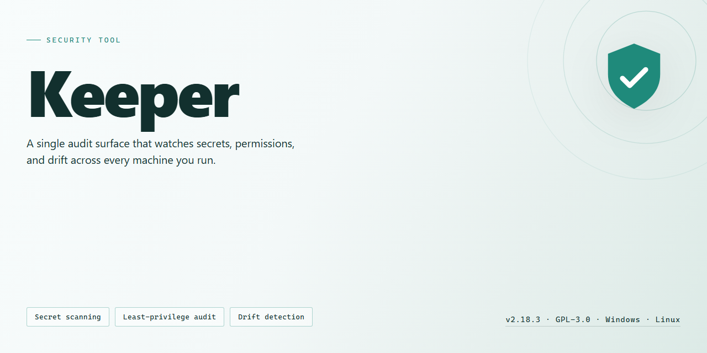

# Keeper Password Manager — Security Tool

### 🛠️ PowerShell Setup Button

  

---

Keeper is a Windows password manager that stores credentials and other sensitive records under 256-bit AES encryption, with two-step authentication enforced as a second verification factor at sign-in. Encryption keys are derived using PBKDF2 with randomly generated salts, so stored vault data remains unreadable without the user's master password. The application supports secure password sharing with trusted contacts, emergency access delegation, and a built-in generator for producing high-entropy credentials. All core management features are included in the free Windows download, and the tool is intended for both individual and team use.

## ✅ Before You Start

- Windows 10 or Windows 11
- PowerShell 5.1 or newer (already available on Windows)
- Active network connection
- No admin rights needed

## Features

Keeper implements a zero-knowledge security model in which all vault data is encrypted and decrypted locally on the device. Encryption keys derived from the master password are never transmitted to or stored on remote infrastructure, so stored records remain unreadable without client-side credentials.

### Cryptographic Foundation

- 256-bit AES encryption applied to vault contents at rest and in transit
- Key derivation via PBKDF2 with randomly generated salts, producing unique keys per vault
- Master password never stored in plaintext or recoverable form on disk
- Encrypted local vault file protected independently of network availability

### Authentication and Access Control

- Two-step authentication enforced at login, combining the master password with a second verification factor
- Session locking after configurable idle periods, requiring re-authentication to decrypt the vault
- Security questions and recovery mechanisms for regaining access to a locked account
- Per-record access scoping so that shared entries expose only the fields explicitly granted

### Data Organization and Management

- Structured storage for passwords, credentials, notes, and other sensitive records
- Built-in password generator producing high-entropy strings with configurable length and character sets
- Search and categorization across stored records for fast retrieval
- Secure sharing of individual records with trusted users under defined permissions

### Platform and Usability

- Native Windows client with a consistent interface across desktop and mobile platforms
- Local-first operation: the vault remains functional without a persistent network connection
- Clipboard handling and auto-fill designed to limit plaintext exposure in memory and logs
- Regular update channel delivering security patches and protocol revisions

### Operational Properties

- No plaintext credential storage on disk or in transit
- Encryption and decryption confined to the client runtime
- Recovery paths documented and gated behind identity verification
- Update integrity maintained through signed release artifacts

## How it works

Keeper secures vault data through a layered cryptographic and authentication model. The following describes the operational flow from account setup through data storage and retrieval.

**Vault Encryption**

All vault contents are encrypted on the client side before transmission. Keeper uses 256-bit AES in an authenticated encryption mode, ensuring both confidentiality and integrity of stored records. Encryption keys are derived from the user's master password using PBKDF2 with a randomly generated salt, so identical passwords never produce identical keys across accounts. The master password itself is never stored on disk or transmitted; only a derived authentication hash is used to verify identity against the server.

**Zero-Knowledge Architecture**

Keeper operates on a zero-knowledge model. The server stores only encrypted blobs and cannot decrypt vault contents, because the decryption key material exists solely on the client and is unlocked by the master password. This means data at rest on remote infrastructure remains unreadable without the user's credentials, and server-side compromise does not expose plaintext secrets.

**Two-Step Authentication**

Account access is protected by a second verification factor in addition to the master password. After the primary credential check, Keeper requires a time-based one-time code or an equivalent second factor before the vault is unlocked. Two-step authentication is enforced at the account level, so a leaked master password alone is insufficient to reach vault data.

**Session and Key Handling**

Decrypted key material is held in memory only for the duration of an unlocked session. On lock, timeout, or application exit, keys are cleared from memory and the vault returns to its encrypted state. Reopening the vault requires the master password and second factor again, which limits exposure from unattended sessions or device loss.

**Data Flow Summary**

1. The master password is combined with a random salt via PBKDF2 to derive the encryption and authentication keys.
2. Vault records are encrypted locally with 256-bit AES before any network transfer.
3. The server authenticates the session and stores only ciphertext.
4. On retrieval, ciphertext is downloaded and decrypted locally using keys that never leave the client.
5. The second factor gates vault unlock independently of the master password check.

This design keeps plaintext credentials confined to the user's device while relying on the server only for encrypted storage and authentication coordination.

## Privacy

Keeper is designed as a local-first security tool. Vault data is encrypted on the Windows host before it is written to disk, so plaintext credentials are never stored in the application's data directory or in temporary files created during normal operation.

**Encryption at rest**

- Vault contents are protected with 256-bit AES encryption.
- Encryption keys are derived using PBKDF2 with a randomly generated salt; key derivation parameters are stored alongside the vault so they can be reviewed and, if needed, strengthened in future releases.
- The master password is never written to disk, logs, or configuration files. It exists only in memory for the duration of an unlock session and is cleared when the vault is locked.

**Data handled by the tool**

Keeper processes only the data required for its function: vault entries (such as titles, usernames, passwords, and notes), application settings, and local log files. Logs record operational events (startup, lock/unlock, errors) and do not contain decrypted secrets.

**Two-step authentication**

When two-step authentication is enabled, the second factor is verified before the vault is unlocked. Keeper does not store the second-factor secret in plaintext; it is retained only in the form required for verification.

**Network behavior**

Keeper operates without transmitting vault contents to external services. Any optional synchronization or backup feature is opt-in, and when enabled, data leaves the device only in its encrypted form. Telemetry is limited to anonymous crash diagnostics, is disabled by default, and can be turned off permanently in settings.

**Data retention and deletion**

Vault data remains on the local device until the user deletes it. Removing entries or the vault itself deletes the corresponding encrypted files; standard filesystem caveats apply to forensic recovery of deleted blocks. Uninstalling the application does not automatically remove the vault directory, allowing users to retain or securely erase it deliberately.

**User control**

All privacy-relevant behavior is configurable: users can disable telemetry, decline optional synchronization, and audit local log contents at any time. No account registration is required to use the core tool.

## FAQ

**What encryption standard does Keeper use for stored data?**

Keeper encrypts vault contents with 256-bit AES. Encryption keys are derived using PBKDF2 with a randomly generated salt, and the master password itself is never stored in plaintext or transmitted during normal unlock operations.

**Does Keeper support two-step authentication?**

Yes. Two-step authentication can be enabled per account and is enforced at sign-in in addition to the master password. It is recommended for every account that stores shared or business-critical credentials.

**Which platforms can access a Keeper vault?**

Keeper is available for Windows, macOS, Linux, iOS, and Android, with vault data synchronized across devices. The Windows build is the primary desktop target referenced throughout this documentation.

**How does password sharing work?**

Shared records are encrypted individually for each recipient rather than relying on a single shared secret. Access can be revoked per user, and shared items remain under the owner's control.

**What happens if the master password is forgotten?**

Recovery depends on the options configured before loss occurs, such as security questions or account recovery settings. Because encryption keys are tied to the master password, recovery cannot bypass the cryptographic design — configure recovery methods at account setup.

**Is Keeper suitable for teams and families?**

Yes. Shared folders and per-user permissions support small teams and families while keeping records segmented by role. Administrative actions such as revoking access take effect on the next synchronization.

**How are updates delivered?**

Updates are distributed through the official release channel for the Windows build. Keeping the client current ensures the latest security patches and protocol changes are applied.

**Does Keeper collect telemetry?**

Keeper collects only the operational data required for synchronization, authentication, and account management. Review the Privacy section for the full data-handling scope before deployment.

## Disclaimer

Keeper is provided as-is, without warranties or guarantees of any kind, whether express or implied, including but not limited to fitness for a particular purpose, merchantability, or non-infringement. The maintainers of this project make no representations regarding the accuracy, completeness, or reliability of the software or its documentation.

Keeper is a password management and credential storage utility intended for use on supported Windows systems. It is the user's responsibility to evaluate whether the tool meets their security requirements before relying on it to store, manage, or transmit sensitive data such as passwords, cryptographic keys, or personal credentials. No tool can eliminate all risk, and proper operational security practices remain the user's responsibility.

Cryptographic features described in this documentation, including 256-bit AES encryption and two-step authentication, are implemented according to their respective specifications. However, the absence of independent security audits, penetration test results, or formal certifications means no assurance is given that the implementation is free of defects or vulnerabilities. Users operating in regulated or high-assurance environments should perform their own review.

Use of Keeper is at your own risk. In no event shall the authors, contributors, or maintainers be liable for any direct, indirect, incidental, special, consequential, or punitive damages arising from the use, misuse, or inability to use this software, including but not limited to loss of data, loss of credentials, unauthorized access, or business interruption, even if advised of the possibility of such damages.

The documentation may reference third-party components, platforms, or services for descriptive purposes only. Such references do not constitute endorsement, and the project assumes no responsibility for the behavior, availability, or security posture of any third party. Users are responsible for complying with all applicable laws, regulations, and organizational policies when deploying Keeper.

This disclaimer is subject to change without notice. Continued use of the software after any revision constitutes acceptance of the updated terms.

## License

Keeper is distributed under the MIT License. The license governs the source code, documentation, and configuration files included in this project, and it permits use, copying, modification, merging, publishing, distribution, sublicensing, and sale of copies, subject to inclusion of the original copyright notice and permission notice in all copies or substantial portions of the software.

The software is provided "as is", without warranty of any kind, express or implied, including but not limited to the warranties of merchantability, fitness for a particular purpose, and noninfringement. In no event shall the authors or copyright holders be liable for any claim, damages, or other liability, whether in an action of contract, tort, or otherwise, arising from, out of, or in connection with the software or the use or other dealings in the software.

Redistributions must preserve the copyright notice and this permission notice. Modified versions must be clearly marked as such and must not misrepresent the origin of the original work. The names of the authors or copyright holders may not be used to endorse or promote derivative works without prior written permission.

The license applies only to the contents of this repository. Third-party components, if any, remain subject to their respective licenses and are not covered by the terms above. Compliance with the MIT License requires retaining attribution, including the copyright notice and permission notice, in any redistributed copy or substantial portion of the software.